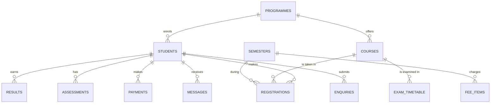

# Phase 3 — Design

## 3.1 Architecture (3-tier)
```
┌────────────── Browser ──────────────┐      ┌──────────── Node.js / Express ────────────┐     ┌─────────┐
│ index.html  (login)                 │ HTTP │ securityHeaders → json → session          │ SQL │ SQLite  │
│ dashboard.html + js/app.js (router) │─────►│ /api/auth/*        (public: login)         │────►│portal.db│
│ js/views/*.js  (one file per area)  │ JSON │ requireAuth → /api/me, academics, finance, │     └─────────┘
│ css/base.css, login.css, portal.css │◄─────│               communication               │
└─────────────────────────────────────┘      │ express.static(client/)                    │
                                             └────────────────────────────────────────────┘
```
- **Presentation tier:** static HTML/CSS/JS. `dashboard.html` is a single-page shell; the hash
  router (`#/results`, `#/pay/ecocash`) swaps views without reloading.
- **Application tier:** Express routers grouped by domain. Business rules (grading, registration
  validation) are pure functions in `src/lib/`, so they can be unit-tested without HTTP or a DB.
- **Data tier:** SQLite through `better-sqlite3`. Multi-row writes use transactions.

`createApp({ db })` takes the database as a parameter (dependency injection), so the tests run
the same app against an in-memory database.

## 3.2 Sitemap
```
/  (landing page — choose a portal; logged-in users skip straight to their portal)
├── /staff.html  (staff login) ──► /staff-portal.html
│       #/dashboard · #/results · #/fees · #/accounts · #/audit   (menu depends on role)
└── /student.html  (student login)
    └── /dashboard.html
    ├── #/dashboard        tiles, banner, personal details, registered courses
    ├── #/registration     New Registration
    ├── #/fees             Fees quote (printable)
    ├── #/pay/ecocash      Pay tuition fees (EcoCash)
    ├── #/pay/online       Pay online (FBC)
    ├── #/payments         Payments history
    ├── #/results          Examinations results
    ├── #/assessments      Continuous assessment
    ├── #/timetable        Exams timetable (printable)
    ├── #/messages         Inbox (mail icon)
    ├── #/enquiries        Enquiries
    ├── #/calendar         Academic calendar
    ├── #/password         Change password
    └── #/elearning, #/webmail   placeholders
```

## 3.3 Wireframes (from the real portal)
```
Login                                        Dashboard
┌──────────────────────────────────────┐     ┌──────────────────────────────────────────────┐
│        [crest]  NATIONAL UNIVERSITY… │     │ ☰ NUST STUDENT PORTAL   [✉ 0]        [Logout]│
├─────────╲────────────────────────────┤     ├──────────┬───────────────────────────────────┤
│ yellow   ╲   ┌──────────────────┐    │     │ (crest)  │ [FEES][PAY][ONLINE][ENQ][APP]     │
│          ╲   │ STUDENTS PORTAL  │    │     │ Name     │ ┌ ARE YOU A REGISTERED STUDENT? ┐ │
│ [crest]   ╲  │ [student number] │    │     │ ▸Dashboard│ ├───────────────┬──────────────┤ │
│            ╲ │ [password      ] │    │     │  Registr. │ │PERSONAL DET.  │REGISTERED    │ │
│             ╲│     [LOG IN]     │    │     │  Payments │ │ name, ID, addr│ code|name|typ│ │
│              └──────────────────┘    │     │  Results… │ └───────────────┴──────────────┘ │
└──────────────────────────────────────┘     └──────────┴───────────────────────────────────┘
```
Palette taken from the screenshots: navy `#0b1c4f`, sidebar slate `#3f4d5c`, panel header
`#1f6a8a`, tiles green/cyan/red/orange/teal, login yellow `#fbbf13`, login button `#0b95ec`.

## 3.4 Database (ERD)

Full definitions are in `server/src/schema.sql`. Design decisions:
- Money is stored as **integer cents** (`amount_cents`), because floating point can't represent 0.10 exactly.
- `UNIQUE(student_id, course_code, semester_id)` stops duplicate registrations at the database level.
- `CHECK` constraints enforce valid enums and mark ranges, even if the API has a bug.
- `ON DELETE CASCADE` from students keeps child tables consistent.
- Fees are per semester, not per programme. This keeps the prototype simple and is noted for v0.2.

## 3.5 REST API
All responses are JSON. Errors are `{ "error": "message" }`. 🔒 = session required.

| Method | Path | Description |
|--------|------|-------------|
| POST | `/api/auth/login` | `{studentNumber, password}` → starts session |
| POST | `/api/auth/logout` | Ends session (204) |
| GET 🔒 | `/api/auth/me` | Name, student number, unread count |
| PUT 🔒 | `/api/auth/password` | `{currentPassword, newPassword}` |
| GET 🔒 | `/api/me/dashboard` | Profile, current semester, registered courses |
| GET 🔒 | `/api/registration` | Courses for the student's level with registered flags |
| POST 🔒 | `/api/registration` | `{courseCodes: []}` replaces the semester's registration |
| GET 🔒 | `/api/results` | Results grouped by semester, with averages |
| GET 🔒 | `/api/assessments` | Current semester CA marks |
| GET 🔒 | `/api/timetable` | Exams for registered courses |
| GET 🔒 | `/api/fees/quote` | Fee items, total, paid, balance |
| GET 🔒 | `/api/payments` | Payment history |
| POST 🔒 | `/api/payments` | `{method, amount, phone?}` — simulated |
| GET 🔒 | `/api/messages` | Inbox + unread count |
| PATCH 🔒 | `/api/messages/:id/read` | Mark read (own messages only) |
| GET 🔒 | `/api/enquiries` | Categories + my enquiries |
| POST 🔒 | `/api/enquiries` | `{category, subject, message}` |

Status codes: 200/201/204 success · 400 validation · 401 not logged in · 404 not found ·
409 registration closed · 429 too many login attempts · 500 server error.

## 3.6 Staff portal (v0.2)

### Roles (role-based access control)
| Role | Results | Fees & accounts | Activity log |
|------|---------|-----------------|--------------|
| ACADEMIC (Lecturer) | ✔ | ✖ | ✖ |
| BURSARY | ✖ | ✔ | ✖ |
| ADMIN | ✔ | ✔ | ✔ |

`requireStaff('BURSARY')` re-reads the staff row on every request, so deactivating an account or
changing a role takes effect immediately. The menu hides what a role can't use, but the server is
what actually enforces it.

### Result publishing workflow
```
(no mark) ──save──► DRAFT ──publish──► PUBLISHED ──edit──► DRAFT ──publish──► …
                     (hidden from student)   (visible + message sent)
```

### Schema changes — migration `001_staff_and_publishing.sql`
`staff` table · `results.published / updated_by / updated_at` · `payments.recorded_by` · `audit_log` table.
`db.js` applies each numbered file in `migrations/` whose number is above `PRAGMA user_version`,
inside a transaction. Existing databases upgrade without losing data. Existing results default to
`published = 1`, so nothing disappears for students.

### Staff API (all 🔒 staff session; role in brackets)
| Method | Path | Description |
|--------|------|-------------|
| POST | `/api/staff/auth/login` · `/logout` | Staff session |
| GET | `/api/staff/auth/me` | Name, role |
| GET | `/api/staff/overview` | Headline stats (any staff) |
| GET | `/api/staff/results/options` | Semesters + courses [ACADEMIC] |
| GET | `/api/staff/results?semester=&course=` | Class list with marks and status [ACADEMIC] |
| PUT | `/api/staff/results` | `{semesterId, courseCode, marks:[{studentNumber, mark\|null}]}` save drafts [ACADEMIC] |
| POST | `/api/staff/results/publish` | Publish drafts + notify students [ACADEMIC] |
| GET/POST | `/api/staff/fees` | List / add fee items [BURSARY] |
| PUT/DELETE | `/api/staff/fees/:id` | Edit / delete fee item [BURSARY] |
| GET | `/api/staff/accounts?semester=` | All students' balances [BURSARY] |
| GET | `/api/staff/accounts/:number` | One student's account [BURSARY] |
| POST | `/api/staff/accounts/:number/payments` | Record bank deposit [BURSARY] |
| GET | `/api/staff/audit` | Latest 200 actions [ADMIN] |

New status code: **403** = logged in but not allowed.

## 3.7 Security design
| Threat | Control |
|--------|---------|
| Password theft from DB | bcrypt (cost 10) |
| Brute force | Login limiter (5 / 15 min / IP) |
| Account enumeration | Same message and same bcrypt timing for unknown users |
| Session fixation | `req.session.regenerate()` on login |
| XSS | `html` tagged template escapes all values; CSP `script-src 'self'` |
| SQL injection | Prepared statements only |
| CSRF | `SameSite=Lax` cookie + JSON-only API (cross-site forms can't send `application/json`) |
| Clickjacking | `X-Frame-Options: DENY`, `frame-ancestors 'none'` |
| IDOR | Every student query filters by `req.session.studentId`, never by an ID from the client |
| Privilege escalation | `requireStaff(role)` on every staff route; student sessions can't reach `/api/staff` |
| Repudiation ("I didn't change that mark") | `audit_log` + `updated_by` / `recorded_by` columns, written in the same transaction as the change |
